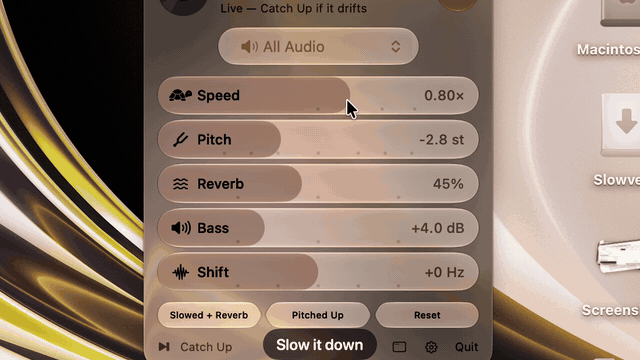

# Slowverb

<p align="center"></p>

<p align="center"><a href="https://github.com/wlofy/slowverb/releases/latest"><b>⬇ Download for macOS</b></a> · free &amp; open source</p>

Make a slowed + reverb version of any song, live, from your Mac's menu bar or its own window. Slowverb is **free and open source**, and contributions are welcome. Slowverb captures audio from one app (Spotify, Chrome/YouTube, Music…) or the whole system, mutes the original, and plays it back with your own speed, pitch and reverb.

- A spinning record logo with the album art on its label; the UI takes its colors from the art
- Liquid Glass controls on macOS 26+, with frosted fallbacks on older systems
- Double-click any slider to reset it; sliders snap to useful values with a trackpad tick
- Control Center–style sliders for **Speed**, **Pitch**, **Reverb**, **Bass** boost and frequency **Shift**
- One-tap presets: **Slowed + Reverb**, **Pitched Up**, **Reset**
- Stays in sync with Spotify and Music, so songs never get cut off or overlap
- Choose which app to capture, or use **All Audio**
- Settings: accent and vinyl colors, now-playing display, match colors to album art
- Settings are remembered between launches
- A few Swift files, no dependencies, builds without Xcode

## Install

1. Download the latest `Slowverb-x.y.z.dmg` from [Releases](https://github.com/wlofy/slowverb/releases).
2. Open it and drag **Slowverb** onto **Applications**.
3. The first time you open it, macOS will say it can't verify the developer, because the app isn't notarized by Apple. Go to **System Settings › Privacy & Security** and click **Open Anyway**. You only need to do this once.

## Requirements

macOS 14.4 or later (uses Core Audio process taps) and the Xcode Command Line Tools (`xcode-select --install`).

## Build & run

```sh
./build.sh          # build/Slowverb.app
./package.sh        # build/Slowverb-<version>.dmg for distribution
open build/Slowverb.app
```

Click the record in the menu bar (or open the app window) and press the power button, or click the record itself. The first time you do this, macOS asks for permission to record system audio. If you deny it, you can allow it later in **System Settings › Privacy & Security › Screen & System Audio Recording**.

To run the self-checks (ring buffer, frequency shifter, artwork color): `./test.sh`.

## How it works

`CATapDescription` + `AudioHardwareCreateProcessTap` capture the selected app's audio and mute it at the source. The captured audio goes into a ring buffer, then through `AVAudioEngine`: a frequency shifter → `AVAudioUnitTimePitch` (speed and pitch) → `AVAudioUnitReverb` → `AVAudioUnitEQ` low shelf (bass) → speakers.

The frequency shifter moves every frequency by the same number of Hz, while pitch shifting scales them. The result sounds metallic or detuned. Small values (±5–30 Hz) give a wobbly, phasey sound.

## Staying in sync

Slowed audio plays back more slowly than the app sends it, so within a song the slowed version simply falls behind (Slowverb holds up to 3 minutes). With **Spotify** or **Music** as the source, when the next song starts Slowverb pauses the app, finishes the slowed song, then restarts the next song from 0:00. You never hear this, because the original is muted, and every song plays in full and in order. The first time this happens, macOS asks you to let Slowverb control the app.

If you skip a song partway through, the rest of the old song is dropped. If a song ends on its own, its ending still plays.

## Limitations

- **Speed tops out at 1×.** Live audio can't be played faster than it arrives. For a "sped up" sound, use **Pitched Up**.
- **Browsers and All Audio aren't kept in sync**: they can't be paused remotely, so slowed audio falls behind (up to 60 s). Press **Catch Up** to jump back to live audio.
- **Safari** plays audio through a WebKit helper process, so it doesn't appear in the app list. Use **All Audio** instead.
- **App icon:** a minimal record on the standard macOS icon shape, dark so it suits both light and dark mode. Separate dark, clear and tinted versions for macOS 26 need an Icon Composer `.icon` file compiled with Xcode; this build only uses the Command Line Tools.
- **Control Center:** third-party Control Center controls only support toggles and buttons, not sliders, so the full controls live in the menu bar.

## Contributing

Slowverb is a community project, and new effects, presets, player support and fixes are all welcome. See [CONTRIBUTING.md](CONTRIBUTING.md) to get started.

## License

MIT. Made by [wlofy](https://github.com/wlofy).
